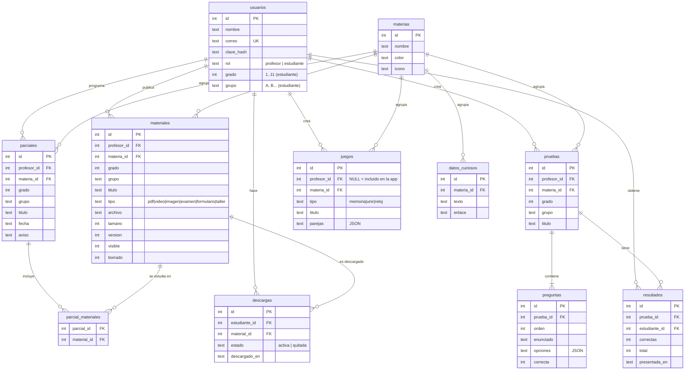

# Biblioteca Digital — API (etapa 3: Backend)

API de la aplicación *Biblioteca digital para aprender y jugar, incluso sin internet*.
Desarrollo de aplicaciones móviles · Corporación Universitaria Autónoma del Cauca · Edwin David Ossa Quina.

- **Node.js puro** (sin dependencias: no hay que hacer `npm install`).
- **Base de datos SQLite** con el módulo incluido en Node (`node:sqlite`). Se crea sola en `data/biblioteca.db`.
- **Autenticación JWT** (HS256) y contraseñas cifradas con `scrypt`.
- **Pruebas**: 14 pruebas automáticas (`npm test`) y una colección de Postman con 53 verificaciones.

## Cómo ejecutarla

Requisito: **Node.js 22.13 o superior** (`node -v`). Se descarga en https://nodejs.org (versión LTS).

```bash
cd backend
node server.js        # o: npm start
```

La consola muestra las direcciones:

| Desde dónde | URL |
|---|---|
| El mismo computador / Postman | `http://localhost:3000` |
| Emulador de Android Studio | `http://10.0.2.2:3000` |
| Celular real (misma red Wi-Fi) | `http://<IP del computador>:3000` |

Variables opcionales: `PUERTO` (por defecto 3000), `CARPETA_DATOS` (por defecto `./data`), `JWT_SECRETO`.
Para empezar de cero, detén el servidor y borra la carpeta `data/`.

## Pruebas

```bash
npm test                 # pruebas automáticas (servidor en memoria, no toca tus datos)
npm run postman          # ejecuta la colección de Postman contra http://localhost:3000 (el servidor debe estar encendido)
```

**En Postman:** *Import* → `postman/Biblioteca.postman_collection.json`. Para las peticiones con archivo,
ve a *Settings → General → Working directory* y elige la carpeta `postman` (ahí están `archivos-prueba/tablas_del_2.pdf` y `vaca.png`).
Luego abre la colección → *Run* y ejecuta todo en orden: cada petición guarda en variables los tokens e ids que usa la siguiente.

## Reglas de negocio

1. Solo el **profesor** publica (material, pruebas, parciales, juegos, datos) y siempre para una **materia, grado y grupo**.
2. El **estudiante** solo ve lo **visible** de **su grado y grupo**.
3. Cada estudiante tiene como máximo **10 descargas activas**. Volver a bajar algo que ya tiene (o su nueva versión) no gasta cupo; quitar una descarga libera cupo.
4. Si el profesor **oculta o borra** un material, las descargas activas pasan a **quitada**.
5. Cuando el profesor **actualiza el archivo**, sube la **versión**; al sincronizar, la app baja la nueva versión.
6. Una prueba se califica **en el servidor** y cuenta **el primer intento** (los repetidos no cambian la nota). Las pruebas resueltas sin internet se envían después con la fecha en que se presentaron.
7. Cada profesor solo puede modificar o borrar **su propio** contenido.

## Modelo de datos



## Endpoints

Todas las rutas (menos registro, login, salud, materias e imágenes) requieren `Authorization: Bearer <token>`.
Errores: `{ "error": "mensaje" }` con 400 (datos inválidos), 401 (sin sesión), 403 (sin permiso), 404, 409 (correo repetido o límite de descargas).

### Generales y autenticación
| Método | Ruta | Quién | Pantalla del prototipo |
|---|---|---|---|
| GET | `/api/salud` | todos | — |
| GET | `/api/materias` | todos | Elegir materia |
| POST | `/api/auth/registro` | todos | Crear cuenta `{rol, nombre, correo, clave, grado?, grupo?}` |
| POST | `/api/auth/login` | todos | Ya tengo cuenta `{correo, clave, rol?}` |
| GET | `/api/auth/yo` | con sesión | Encabezado "¡Hola!" |

### Profesor
| Método | Ruta | Pantalla |
|---|---|---|
| GET | `/api/profesor/resumen?materia_id&grado&grupo` | 1 · Elige materia y grupo (contadores y "lo último que publicaste") |
| POST | `/api/materiales` *(multipart: titulo, tipo, materia_id, grado, grupo, archivo)* | 2 · Sube el material |
| GET | `/api/materiales?materia_id&grado&grupo` | 5 · Lista de material |
| PATCH | `/api/materiales/:id` `{visible?, titulo?}` | 5 · Visible / Oculto |
| PUT | `/api/materiales/:id/archivo` *(multipart: archivo)* | 5 · Actualizar archivo |
| DELETE | `/api/materiales/:id` | 5 · Borrar |
| POST | `/api/pruebas` `{titulo, materia_id, grado, grupo, preguntas:[{enunciado, opciones[], correcta}]}` | 3 · Crea una evaluación |
| GET | `/api/pruebas`, `/api/pruebas/:id` | 3 / 7 |
| DELETE | `/api/pruebas/:id` | — |
| GET | `/api/pruebas/:id/resultados` | 7 · Resultados |
| POST | `/api/parciales` `{titulo, fecha, aviso, materia_id, grado, grupo, material_ids[]}` | 4 · Programa parciales |
| GET / DELETE | `/api/parciales`, `/api/parciales/:id` | 4 |
| GET | `/api/profesor/descargas?grado&grupo&materia_id?` | 6 · Quién descargó qué |
| POST | `/api/juegos/imagenes` *(multipart: imagen)* | 8 · Foto de una pareja |
| POST | `/api/juegos` `{tipo, titulo, materia_id, grado, grupo, parejas:[{palabra, imagen?, archivo?}]}` | 8 · Juegos con tu contenido |
| GET / DELETE | `/api/juegos`, `/api/juegos/:id` | 8 |
| GET / POST / DELETE | `/api/datos`, `/api/datos/:id` | Datos curiosos |
| GET | `/imagenes/:archivo` | Imagen de un juego |

### Estudiante
| Método | Ruta | Pantalla |
|---|---|---|
| GET | `/api/estudiante/sync` | 8 · Actualizar: baja materias, material, pruebas (con preguntas y su nota), parciales, juegos, datos y el contador de descargas |
| GET | `/api/materiales/:id/descargar` | 2 · Descargar (máx. 10 activas). Cabecera `X-Version` |
| POST | `/api/descargas/:materialId/quitar` | Liberar un cupo |
| POST | `/api/pruebas/:id/responder` `{respuestas:[0,2,1]}` | 4 · Responde la prueba (con internet) |
| POST | `/api/estudiante/enviar` `{resultados:[{prueba_id, respuestas, presentada_en}], quitadas:[ids]}` | 8 · Enviar al profesor lo hecho sin internet |

## Estructura

```
backend/
├── server.js                 # arranque
├── src/
│   ├── framework.js          # servidor HTTP, rutas, JSON y multipart
│   ├── db.js                 # esquema SQLite y datos iniciales (materias, juegos, datos curiosos)
│   ├── auth.js               # contraseñas, JWT y permisos por rol
│   ├── validar.js            # validaciones y reglas (máx. 10 descargas)
│   └── app.js                # todos los endpoints
├── test/api.test.js          # pruebas automáticas
├── postman/                  # colección de Postman + archivos de prueba
└── tools/                    # generar y ejecutar la colección desde la terminal
```
